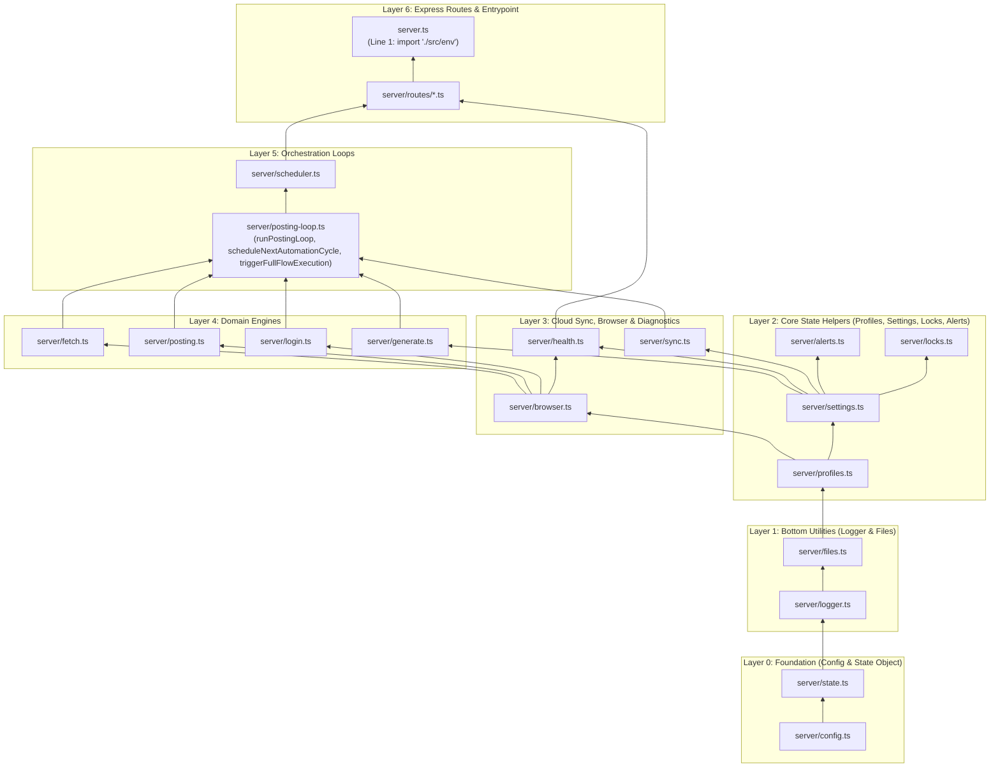

# Modular Split Plan (`server.ts` & `src/App.tsx`)

> **Goal:** Split the large monolithic files (`server.ts` at 9,628 lines and `src/App.tsx` at 9,178 lines) into small, single-purpose modules without changing any URLs, API responses, UI text, styling, colours, layout, or runtime behaviour.

---

## 1. Current Baseline Metrics (Before Split)

### 1.1 Source Files
| File | Lines | Size (Bytes) | Role |
|---|---:|---:|---|
| `server.ts` | 9,628 | 403,848 | Monolithic Express server, Playwright automation, scheduler, LLM, and routes |
| `src/App.tsx` | 9,178 | 502,268 | Monolithic React UI containing all 6 pages, modals, state, and polling |
| `src/api.ts` | 630 | 19,966 | Typed frontend API client and `apiFetch` timeout wrapper |
| `src/utils/scheduler.ts` | 606 | 22,785 | Pure scheduler due-time, ordering, and peak-session calculations |
| `src/storage.ts` | 533 | 15,974 | Unified dual-cloud storage facade (Firebase RTDB + MongoDB fallback) |
| `src/firebase-db.ts` | 406 | 15,254 | Firebase Realtime Database adapter |
| `src/mongo-db.ts` | 365 | 13,237 | MongoDB Atlas adapter |
| `src/utils/formatters.ts` | 258 | 11,148 | Comment cashtag cleaning, CSV escaping, and cookie validation |
| `src/index.css` | 176 | 4,283 | Tailwind CSS v4 imports, animations, and unified dark scrollbar styles |
| `src/main.tsx` | 13 | 293 | React DOM root mounting `<App />` inside `<ErrorBoundary>` |
| `src/env.ts` | 4 | 68 | Dotenv preload initializer |
| **Total Source** | **21,797** | **1,009,124** | **11 source files** |

### 1.2 Built Production Bundles
| Built Artifact | Size (Bytes) | Size (KB) |
|---|---:|---:|
| `dist/server.cjs` | 425,931 | 415.95 KB |
| `dist/assets/index-Dzxy9cJF.js` | 307,052 | 299.86 KB |
| `dist/assets/vendor-react-SaLnwSRd.js` | 223,207 | 217.98 KB |
| `dist/assets/vendor-lucide-CQ1v-6HI.js` | 20,365 | 19.89 KB |
| `dist/assets/index-D5TaX_Xy.css` | 95,853 | 93.61 KB |

---

## 2. Current Sections Inside Large Files

### 2.1 `server.ts` (9,628 lines)
| Line Range | Lines | Section Description |
|---|---:|---|
| `1–168` | 168 | Environment bootstrap (`import "./src/env"`), Playwright browser path detection (`resolvePlaywrightBrowsersPath`), `chromium` loading after `PLAYWRIGHT_BROWSERS_PATH` is set, `OUTPUT_DIR`/`AUTH_DIR` initialization |
| `169–303` | 135 | `isProfileSessionActive`, static `/output/*` security interceptors (`/output/last_trending.json`, `/output/generated_messages.json`, `/output/results.json`, `/api/results`), and `app.use("/output", express.static(OUTPUT_DIR))` |
| `304–366` | 63 | Marketing image selection helpers (`getAvailableMarketingImages`, `getNextSingleMarketingImage`) and `getLocalBotSettings` / `saveLocalBotSettings` |
| `367–452` | 86 | Telegram HTML escaping and throttled emergency alert sender (`sendTelegramAlert`) |
| `453–849` | 397 | Profile schedule normalization, active profile path switching (`updateActiveProfilePaths`), timestamps, `readBotProgress` / `saveBotProgress`, and log buffers (`addLog`, `triggerLogSync`) |
| `850–956` | 107 | Data retention and auto-compaction (`pruneOldAndCompletedData`) |
| `957–1129` | 173 | Playwright installation (`installPlaywrightChromium`) and resilient Chromium launcher with per-profile proxy routing (`launchBrowserResilient`) |
| `1130–1438` | 309 | Core data interfaces (`Coin`, `GeneratedMessage`, `PostResult`, `LoginSession`), runtime state variables, process mutex locks (`acquireProcessLock`, `releaseProcessLock`), and continuous automation loop timers (`triggerFullFlowExecution`, `scheduleNextAutomationCycle`) |
| `1439–1885` | 447 | Browser DOM helpers (`saveDebugScreenshot`, `removeBlockingOverlays`, `clickResiliently`, `fillInputResiliently`, `typeWithHumanRhythm`, `locateAndPrepareCommentEditor`, `setupPageResourceBlocking`, `extractFingerprintDetails`, `isEditorPostButtonRequiringLogin`) |
| `1886–2921` | 1,036 | Automated CoinMarketCap login & OTP verification engine (`checkLoginRealInternal`, `checkLoginReal`, `executeStartLogin`, `executeSubmitOtp`, `executeCancelLogin`) |
| `2922–3777` | 856 | Real browser comment posting & 4-point commit verification engine (`runRealPostingInternal`, `resolveToFirstPartyUrl`, `runRealPosting`) |
| `3778–4135` | 358 | Atomic JSON file I/O, SHA-1 deduplicated cloud sync (`writeJsonFile`, `syncLocalFromCloudIfStale`, `autoSyncSessionToProfiles`) |
| `4136–4614` | 479 | Session & Profile CRUD routes (`/api/get-session`, `/api/save-session`, `/api/clear-session`, `/api/profiles`, `/api/save-profile`, `/api/update-profile-limit`, `/api/update-profile-proxy`, `/api/activate-profile`, `/api/delete-profile`) |
| `4615–4905` | 291 | `/api/health`, `/api/status`, and `/api/set-run-mode` routes |
| `4906–5448` | 543 | Marketing image management helpers (`pruneMarketingImages`, `isValidImageBuffer`, `importImagesFromExternalSources`) and routes (`/api/marketing-images/*`, `/api/settings/image-upload`) |
| `5449–5703` | 255 | `/api/set-continuous-loop` route and system/database/env diagnostic routes (`runSystemDiagnosticsCheck`, `/api/check-system`, `/api/check-mongo`, `/api/verify-env`) |
| `5704–6003` | 300 | Interactive login routes (`/api/check-login`, `/api/start-login`, `/api/submit-otp`, `/api/cancel-login`, `/api/reset-login-state`) and `/api/retry-single` |
| `6004–6608` | 605 | Trending coins scraper & API fetcher (`fetchTrendingByScrape`, `executeFetchTrending`) and OpenAI/Gemini comment generator (`generateMessagesForCoins`, `executeGenerateMessages`) |
| `6609–7531` | 923 | Batch posting loop (`runPostingLoop`) and core bot workflow routes (`/api/fetch-trending`, `/api/generate-messages`, `/api/fetch-and-generate-fresh`, `/api/post-chat`, `/api/stop-posting`, `/api/full-flow`) |
| `7532–8096` | 565 | Storage reset, queue reset, retention routes, admin password auth routes (`/api/auth/*`), `/api/profiles/verify-all`, `/api/logs`, and CSV export download routes (`/api/download/*.csv`) |
| `8097–9269` | 1,173 | Multi-account sequential scheduler engine (`updateProfileLastRun`, `updateProfileSchedule`, `scheduleNextSchedulerCycle`, `runScheduledCycle`) and `/api/scheduler/*` + `/api/profile-schedule` routes |
| `9270–9628` | 359 | Telegram settings/test routes (`/api/telegram/*`), startup cloud hydration (`synchronizeSessionsAndProfilesOnStartup`, `hydrateLocalFromCloud`), `startServer()`, SPA `"*"` static fallback, and exports |

### 2.2 `src/App.tsx` (9,178 lines)
| Line Range | Lines | Section Description |
|---|---:|---|
| `1–65` | 65 | Lucide icon imports and API client imports |
| `66–104` | 39 | `ErrorBoundary` class component |
| `105–252` | 148 | Frontend data interfaces (`Coin`, `GeneratedMessage`, `PostResult`, `LogEntry`, `Profile`) |
| `253–354` | 102 | Fast O(1) array equality helpers (`areLogsEqual`, `areCoinsEqual`, etc.) and `formatTimeAgo` |
| `355–568` | 214 | `CycleCountdown` memoized component and `CustomSelect` portal-style dark dropdown component |
| `569–2939` | 2,371 | `App` state declarations, URL routing (`currentView`), admin auth handlers, scheduler handlers, marketing image handlers, per-page polling `useEffect` hooks, profile switching, and bot command runners |
| `2940–3090` | 151 | Company Admin Access login gate view (`!isAdminAuthenticated`) |
| `3091–3289` | 199 | Global hidden file input and sticky top `<header>` navigation bar |
| `3290–3753` | 464 | `currentView === "admin"` (`Admin Settings` page: Team Security, Telegram Alerts, Data & Queue Cleanup) |
| `3754–4517` | 764 | `currentView === "scheduler"` (`Multi-Account Auto-Scheduler` page) |
| `4518–4899` | 382 | `currentView === "guide"` (`Quick Start & Operations Guide` page) |
| `4900–5110` | 211 | `currentView === "logs"` (`Live Activity and Posting History` page) |
| `5111–5355` | 245 | `currentView === "health"` (`System Health` page) |
| `5356–6260` | 905 | Dashboard Row 1: 24/7 Scheduler Spotlight banner, `Control Center` card, and `Progress` card |
| `6261–7112` | 852 | Dashboard Row 2 (Tabs 1–4): `Campaign Data, Reports & Image Library` header, Trending Coins, Generated Comments, Post Submissions, and CSV Exports & Analytics |
| `7113–7764` | 652 | Dashboard Row 2 (Tab 5): `5. Images Library` upload, rotation, search, grid/list gallery, and pagination |
| `7765–7983` | 219 | External Images Import modal, Full Lightbox Preview modal, and `<footer />` |
| `7984–8665` | 682 | `showSessionModal` (`CoinMarketCap Accounts` 3-tab modal: Email Login, Import Cookies, Saved Accounts) |
| `8666–9178` | 513 | Confirmation modals (Fetch, Generate, Reset Queue, Data Retention, Account Switch, Stale Warning), Floating Toast notification, and `inlineConfirmModal` |

---

## 3. Target Folder Structure & File Responsibilities

### 3.1 Backend (`server/` + `server.ts`)
`server/sync.ts` and `server/state.ts` are split into focused single-purpose modules (`config`, `state`, `logger`, `files`, `profiles`, `settings`, `locks`, `alerts`, and `sync`):

- **`server/config.ts`** (~190 lines): Environment setup, `resolvePlaywrightBrowsersPath` setting `process.env.PLAYWRIGHT_BROWSERS_PATH` strictly before loading Playwright `chromium`, `PORT`, `isOpenAiConfigured`, `isCmcConfigured`, test-isolated `OUTPUT_DIR` / `AUTH_DIR` resolution, and shared backend TypeScript interfaces (`Coin`, `GeneratedMessage`, `PostResult`, `LogEntry`, `ProfileTimestamps`, `BotProgressData`, `LoginSession`, `SystemProcessType`).
- **`server/state.ts`** (~95 lines): Single mutable `st` (`state`) object holding all file paths, bot flags, process locks, login state, scheduler state, timers (`logSyncTimeout`, `activePostingTimeout`, `nextCycleTimeout`, `schedulerCycleTimeout`, `stopSchedulerForceTimer`), buffers (`logs`, `schedulerLogsBuffer`, `lastTelegramAlertTimes`, `globalTelegramTimestamps`), and caches. **Zero `export let` bindings remain anywhere.**
- **`server/logger.ts`** (~80 lines): Bottom-layer log ring-buffer and debounced cloud log sync (`isSchedulerLogMessage`, `triggerLogSync`, `addLog`).
- **`server/files.ts`** (~150 lines): Bottom-layer atomic JSON file I/O and SHA-1 deduplicated cloud write helpers (`getTodayDateString`, `readJsonFile`, `writeJsonFileSyncAtomic`, `getPayloadHash`, `saveSessionStateCloudIfChanged`, `saveProfilesCloudIfChanged`, `writeJsonFile`).
- **`server/profiles.ts`** (~330 lines): Profile & session cookie validation, active profile path switching, result isolation, and profile activation (`sessionHasValidCookies`, `isProfileSessionActive`, `normalizeProfilesWithSchedule`, `getActiveProfileId`, `getNextImportedAccountName`, `ensureProfileDirectory`, `updateActiveProfilePaths`, `getActiveProfile`, `getAccountDailyPostLimit`, `normalizeStateJson`, `getIsolatedResults`, `autoSyncSessionToProfiles`, `activateProfileInternal`).
- **`server/settings.ts`** (~195 lines): Local/cloud bot settings, timestamps, posting progress, and marketing image selection (`getLocalBotSettings`, `saveLocalBotSettings`, `getAvailableMarketingImages`, `getNextSingleMarketingImage`, `getRealTimestamps`, `updateRealFetchTime`, `updateRealGenerateTime`, `clearRealTimestamps`, `readBotProgress`, `saveBotProgress`).
- **`server/locks.ts`** (~90 lines): Process mutex locks, self-healing orphan lock recovery, busy/scheduler state checks, and interruptible sleep (`touchProcessLock`, `acquireProcessLock`, `releaseProcessLock`, `interruptibleSleep`, `isSchedulerRunning`, `isBusy`).
- **`server/alerts.ts`** (~85 lines): Telegram HTML escaping and throttled emergency alert sender (`escapeTelegramHtml`, `sendTelegramAlert`) reading/updating `st.lastTelegramAlertTimes` and `st.globalTelegramTimestamps` on the state object.
- **`server/sync.ts`** (~345 lines): Data retention auto-compaction (`pruneOldAndCompletedData`), throttled cloud-to-local staleness sync (`syncLocalFromCloudIfStale`), and startup cloud hydration (`synchronizeSessionsAndProfilesOnStartup`, `hydrateLocalFromCloud`).
- **`server/browser.ts`** (~565 lines): Playwright browser launcher (`installPlaywrightChromium`, `launchBrowserResilient`, `withTimeout`) and resilient DOM helpers (`saveDebugScreenshot`, `removeBlockingOverlays`, `clickResiliently`, `fillInputResiliently`, `typeWithHumanRhythm`, `locateAndPrepareCommentEditor`, `setupPageResourceBlocking`, `extractFingerprintDetails`, `isEditorPostButtonRequiringLogin`).
- **`server/login.ts`** (~1,055 lines): CoinMarketCap browser authentication and OTP flow (`checkLoginRealInternal`, `checkLoginReal`, `executeStartLogin`, `executeSubmitOtp`, `executeCancelLogin`). *Note: Kept together in one module because `executeStartLogin` and `executeSubmitOtp` share the live Playwright page and OTP modal recovery steps.*
- **`server/posting.ts`** (~775 lines): Single-coin Playwright comment submission and 4-point commit verification (`runRealPostingInternal`, `runRealPosting`).
- **`server/posting-loop.ts`** (~695 lines): Batch posting loop (`runPostingLoop`) and continuous automation cycle functions (`cancelNextAutomationCycle`, `scheduleNextAutomationCycle`, `triggerFullFlowExecution`) kept together in the same file.
- **`server/fetch.ts`** (~405 lines): Trending coins scraping, DEX URL resolver (`resolveToFirstPartyUrl`), and CoinMarketCap/CoinGecko fallback (`fetchTrendingByScrape`, `executeFetchTrending`).
- **`server/generate.ts`** (~310 lines): OpenAI `gpt-4o-mini` and Gemini fallback comment generation (`generateMessagesForCoins`, `executeGenerateMessages`, `formatCommentWithCashtag`).
- **`server/scheduler.ts`** (~750 lines): Multi-account sequential scheduler engine (`updateProfileLastRun`, `updateProfileSchedule`, `cancelNextSchedulerCycle`, `scheduleNextSchedulerCycle`, `runScheduledCycle`).
- **`server/health.ts`** (~380 lines): System diagnostics runner (`runSystemDiagnosticsCheck`), marketing image pruning/validation/import (`pruneMarketingImages`, `isValidImageBuffer`, `importImagesFromExternalSources`), admin session token helpers (`generateAdminToken`, `verifyAdminRequest`), and CSV formula-injection escaping (`escapeCsvField`).
- **`server/routes/output.ts`** (~160 lines): Security-intercepted `/output/last_trending.json`, `/output/generated_messages.json`, `/output/results.json`, `/api/results` routes registered strictly before `app.use("/output", express.static(OUTPUT_DIR))` and `/uploads/marketing_images`.
- **`server/routes/profiles.ts`** (~460 lines): Session and profile management routes (`/api/get-session`, `/api/save-session`, `/api/clear-session`, `/api/profiles`, `/api/save-profile`, `/api/update-profile-limit`, `/api/update-profile-proxy`, `/api/activate-profile`, `/api/delete-profile`, `/api/profiles/verify-all`).
- **`server/routes/status-health.ts`** (~440 lines): `/api/health`, `/api/status`, `/api/set-run-mode`, `/api/check-system`, `/api/check-mongo`, `/api/verify-env`, `/api/logs`.
- **`server/routes/images.ts`** (~400 lines): `/api/marketing-images/*` and `/api/settings/image-upload` routes.
- **`server/routes/login.ts`** (~245 lines): `/api/check-login`, `/api/start-login`, `/api/submit-otp`, `/api/cancel-login`, `/api/reset-login-state`.
- **`server/routes/bot-actions.ts`** (~690 lines): `/api/set-continuous-loop`, `/api/retry-single`, `/api/fetch-trending`, `/api/generate-messages`, `/api/fetch-and-generate-fresh`, `/api/post-chat`, `/api/stop-posting`, `/api/full-flow`.
- **`server/routes/admin-data.ts`** (~440 lines): `/api/clear-all`, `/api/queue/reset-daily`, `/api/data/prune`, `/api/data/retention-stats`, `/api/settings/data-retention`, `/api/download/*.csv`, `/api/auth/*`, `/api/settings/target-coins`, `/api/telegram/*`.
- **`server/routes/scheduler.ts`** (~590 lines): `/api/scheduler/*` and `/api/profile-schedule` routes.
- **`server.ts`** (~145 lines): Starts with `import "./src/env";` as the first line, imports route modules in exact original order, registers the `"*"` SPA fallback route last, defines `startServer()` (skipped when imported in tests), and exports `{ app, startServer, formatCommentWithCashtag }`.

### 3.2 Frontend (`src/`)
- **`src/types.ts`** (~62 lines): Shared interfaces (`Coin`, `GeneratedMessage`, `PostResult`, `LogEntry`, `Profile`, `CustomSelectOption`).
- **`src/utils/ui-helpers.ts`** (~128 lines): `areLogsEqual`, `areCoinsEqual`, `areMessagesEqual`, `areResultsEqual`, `areProfilesEqual`, `formatTimeAgo`.
- **`src/components/ErrorBoundary.tsx`** (~42 lines): `ErrorBoundary` class component.
- **`src/components/CycleCountdown.tsx`** (~42 lines): `CycleCountdown` memoized countdown timer.
- **`src/components/SafeImageDisplay.tsx`** (~77 lines): `SafeImageDisplay` resilient image renderer.
- **`src/components/CustomSelect.tsx`** (~175 lines): `CustomSelect` portal-style dark dropdown menu.
- **`src/components/HeaderNavbar.tsx`** (~196 lines): Top sticky `<header>` navigation bar.
- **`src/components/AdminLoginGate.tsx`** (~151 lines): Company Admin Access login gate screen.
- **`src/components/SessionAccountModal.tsx`** (~692 lines): `CoinMarketCap Accounts` 3-tab modal (`showSessionModal`).
- **`src/components/ModalsLayer.tsx`** (~519 lines): All confirmation modals, external image import modal, full lightbox preview modal, floating toast notification, and inline confirm modal.
- **`src/pages/AdminPage.tsx`** (~491 lines): `/admin` (`Admin Settings` page).
- **`src/pages/SchedulerPage.tsx`** (~794 lines): `/scheduler` (`Multi-Account Auto-Scheduler` page).
- **`src/pages/GuidePage.tsx`** (~406 lines): `/guide` (`Quick Start & Operations Guide` page).
- **`src/pages/LogsPage.tsx`** (~227 lines): `/logs` (`Live Activity and Posting History` page).
- **`src/pages/HealthPage.tsx`** (~263 lines): `/health` (`System Health` page).
- **`src/pages/DashboardControlPanel.tsx`** (~914 lines): Dashboard Scheduler Spotlight banner + `Control Center` + `Progress` card.
- **`src/pages/DashboardDataExplorer.tsx`** (~864 lines): Dashboard `Campaign Data, Reports & Image Library` card (Tabs 1–4: Trending Coins, Generated Comments, Post Submissions, CSV & Analytics).
- **`src/pages/DashboardImageLibrary.tsx`** (~874 lines): Dashboard Tab 5 (`5. Images Library`).
- **`src/pages/DashboardPage.tsx`** (~11 lines): Dashboard container composing `DashboardControlPanel`, `DashboardDataExplorer`, and `DashboardImageLibrary`.
- **`src/hooks/useDashboardPolling.ts`** (~539 lines): Per-page polling and UI effect hooks.
- **`src/hooks/useAppController.ts`** (~1,909 lines): Central state & action handlers hook calling `useDashboardPolling` and returning the complete controller object consumed by `<App />`.
- **`src/App.tsx`** (~42 lines): Thin root shell wiring `useAppController()` to `AdminLoginGate`, `HeaderNavbar`, the active page view, `SessionAccountModal`, and `ModalsLayer`, plus re-exporting `ErrorBoundary`.

---

## 4. Order of Moves (Smallest & Safest First)

1. **Move 1 (Frontend Shared Types, UI Helpers & Standalone Components):**
   - Extract `src/types.ts`, `src/utils/ui-helpers.ts`, `src/components/ErrorBoundary.tsx`, `src/components/SafeImageDisplay.tsx`, `src/components/CycleCountdown.tsx`, and `src/components/CustomSelect.tsx` from `src/App.tsx`.
   - Verify `npm run lint`, `npm test`, `npm run build` and commit.
2. **Move 2 (Frontend Standalone Pages — Admin, Scheduler, Guide, Logs, Health):**
   - Extract `src/pages/AdminPage.tsx`, `src/pages/SchedulerPage.tsx`, `src/pages/GuidePage.tsx`, `src/pages/LogsPage.tsx`, and `src/pages/HealthPage.tsx` from `src/App.tsx`.
   - Verify `npm run lint`, `npm test`, `npm run build` and commit.
3. **Move 3 (Frontend Dashboard Sections & Page):**
   - Extract `src/pages/DashboardControlPanel.tsx`, `src/pages/DashboardDataExplorer.tsx`, `src/pages/DashboardImageLibrary.tsx`, and `src/pages/DashboardPage.tsx` from `src/App.tsx`.
   - Verify `npm run lint`, `npm test`, `npm run build` and commit.
4. **Move 4 (Frontend Header, Admin Gate & Modals):**
   - Extract `src/components/AdminLoginGate.tsx`, `src/components/HeaderNavbar.tsx`, `src/components/SessionAccountModal.tsx`, and `src/components/ModalsLayer.tsx` from `src/App.tsx`.
   - Verify `npm run lint`, `npm test`, `npm run build` and commit.
5. **Move 5 (Frontend State & Polling Hooks — `useDashboardPolling` & `useAppController`):**
   - Extract `src/hooks/useDashboardPolling.ts` and `src/hooks/useAppController.ts`, reducing `src/App.tsx` to a 42-line root component.
   - Verify `npm run lint`, `npm test`, `npm run build` and commit.
6. **Move 6 (Backend Config, State, Logger, Files, Profiles, Settings, Locks, Alerts & Sync):**
   - Extract `server/config.ts`, `server/state.ts`, `server/logger.ts`, `server/files.ts`, `server/profiles.ts`, `server/settings.ts`, `server/locks.ts`, `server/alerts.ts`, and `server/sync.ts`.
   - Run `npx madge --circular --extensions ts server.ts`, `npm run lint`, `npm test`, `npm run build` and commit.
7. **Move 7 (Backend Browser Helpers, Fetch, Generate & Health):**
   - Extract `server/browser.ts`, `server/fetch.ts`, `server/generate.ts`, and `server/health.ts` from `server.ts`.
   - Run `npx madge --circular --extensions ts server.ts`, `npm run lint`, `npm test`, `npm run build` and commit.
8. **Move 8 (Backend Login, Posting, Posting Loop & Scheduler Engines):**
   - Extract `server/login.ts`, `server/posting.ts`, `server/posting-loop.ts` (keeping `runPostingLoop`, `scheduleNextAutomationCycle`, and `triggerFullFlowExecution` in the same file), and `server/scheduler.ts` from `server.ts`.
   - Run `npx madge --circular --extensions ts server.ts`, `npm run lint`, `npm test`, `npm run build` and commit.
9. **Move 9 (Backend Express Routes & Final `server.ts` Shell):**
   - Extract `server/routes/output.ts`, `server/routes/profiles.ts`, `server/routes/status-health.ts`, `server/routes/images.ts`, `server/routes/login.ts`, `server/routes/bot-actions.ts`, `server/routes/admin-data.ts`, and `server/routes/scheduler.ts`, reducing `server.ts` to a ~145-line entrypoint with `import "./src/env";` on line 1.
   - Run `npx madge --circular --extensions ts server.ts`, `npm run lint`, `npm test`, `npm run build` and commit.

---

## 5. Corrected Server Dependency Layers & Risk Mitigations

### 5.1 Corrected Server Dependency Layers (`logger` and `files` at the Bottom)
To guarantee zero circular imports (`npx madge --circular --extensions ts server.ts` reports `No circular dependency found!`), all backend modules follow a strict bottom-up Directed Acyclic Graph (DAG):

- **Layer 0 (`config`, `state`):** `server/config.ts` has zero `server/` imports; `server/state.ts` imports only `server/config.ts`.
- **Layer 1 (`logger`, `files` at the bottom):** `server/logger.ts` depends only on `config.ts`, `state.ts`, and `src/storage.ts`. `server/files.ts` depends only on `config.ts`, `state.ts`, `logger.ts`, and `src/storage.ts`.
- **Layer 2 (`profiles`, `settings`, `locks`, `alerts`):** `server/profiles.ts` depends on Layer 0–1; `server/settings.ts` depends on `profiles.ts` and Layer 0–1; `server/locks.ts` and `server/alerts.ts` depend on `settings.ts` and `state.ts`.
- **Layer 3 (`sync`, `browser`, `health`):** `server/sync.ts` depends on Layers 0–2; `server/browser.ts` depends on `config.ts`, `state.ts`, `logger.ts`, and `profiles.ts`; `server/health.ts` depends on `config.ts`, `state.ts`, `logger.ts`, `settings.ts`, and `browser.ts`.
- **Layer 4 (`login`, `posting`, `fetch`, `generate`):** Depend only on Layers 0–3.
- **Layer 5 (`posting-loop`, `scheduler`):** `server/posting-loop.ts` keeps `runPostingLoop`, `scheduleNextAutomationCycle`, and `triggerFullFlowExecution` together in one file and depends on Layers 0–4. `server/scheduler.ts` depends on Layers 0–4 + `posting-loop.ts`.
- **Layer 6 (`server/routes/*` & `server.ts`):** Route modules depend on Layers 0–5, and `server.ts` imports them in strict registration order.

### 5.2 Key Architectural Safeguards

1. **All Timers, Buffers & Flags on `state` (No `export let`):**
   - Every mutable flag (`botStatus`, `isPostingRunning`, `isSinglePostingRunning`, `isGeneratingRunning`, `isSchedulerCycleRunning`, etc.), timer (`logSyncTimeout`, `activePostingTimeout`, `nextCycleTimeout`, `schedulerCycleTimeout`, `stopSchedulerForceTimer`), and buffer/cache (`logs`, `schedulerLogsBuffer`, `lastTelegramAlertTimes`, `globalTelegramTimestamps`, `lastCloudSavedHash`, `hydratedProfiles`, `activeProfileRunLocks`, `activeAdminSessions`) lives on `st` (`state`) in `server/state.ts`. Zero `export let` declarations exist anywhere in the codebase.
2. **Keep `runPostingLoop`, `scheduleNextAutomationCycle`, and `triggerFullFlowExecution` Together:**
   - These three functions (plus `cancelNextAutomationCycle`) mutually schedule and invoke one another during continuous automation cycles and are kept in `server/posting-loop.ts` to prevent circular imports.
3. **Express Route Order & Static `/output` Interception (Tested in `tests/routes.test.ts`):**
   - `server/routes/output.ts` is imported first and registers `/output/last_trending.json`, `/output/generated_messages.json`, `/output/results.json`, and `/api/results` strictly before `app.use("/output", express.static(OUTPUT_DIR))`.
   - `server.ts` registers the `"*"` SPA fallback route last after all `/output` and `/api` route modules.
   - `tests/routes.test.ts` verifies both the router stack order (`_router.stack` indices) and runtime interception when an unauthenticated request fetches `/output/last_trending.json`.
4. **Environment & Playwright Load Order (`import "./src/env"` First Line):**
   - `import "./src/env";` is the very first line of `server.ts`.
   - `server/config.ts` resolves and assigns `process.env.PLAYWRIGHT_BROWSERS_PATH` before `customRequire("playwright")` loads `chromium`.
   - `tests/routes.test.ts` verifies that `GET /api/check-system` finds the installed Chromium executable (`playwrightInstalled: true`, `executableExists: true`).
5. **Test Import Isolation (No Listener, No Scheduler, No Real Data Touched):**
   - Importing `{ app }` from `server.ts` when `NODE_ENV === "test"` or `VITEST` is set does not call `startServer()`, does not start background `setTimeout` timers or the scheduler, isolates `OUTPUT_DIR` and `AUTH_DIR` to `os.tmpdir()`, and skips cloud writes so real `auth/`, `output/`, and cloud data are never touched.
6. **Cycle Verification After Every Server Move:**
   - Run `npx madge --circular --extensions ts server.ts` after every server move and confirm `No circular dependency found!`.

---

## 6. Follow-Up Items & Files Over 1,000 Lines

### 6.1 Follow-Up Items (Kept Intact Without Merging)
1. **Two Distinct `formatCommentWithCashtag` Implementations:**
   - `server/generate.ts` (re-exported by `server.ts`) prepends missing cashtags with a space (`"$SYM ${cleaned}"`) and collapses doubled leading cashtags to `"$SYM "`.
   - `src/utils/formatters.ts` prepends missing cashtags with a hyphen (`"$SYM - ${cleaned}"`) and collapses doubled leading cashtags to `"$SYM - "` (tested by `tests/formatters.test.ts`).
   - **Rule:** Do **NOT** merge these two functions during the split because they behave differently. Keep both intact and track reconciling their separator format as a future follow-up.
2. **Duplicate Helper Variants Between `server/profiles.ts`, `server/health.ts`, and `src/utils/formatters.ts`:**
   - `sessionHasValidCookies` and `normalizeStateJson` in `server/profiles.ts` have stricter CMC-specific cookie checks and 1-year expiry normalization compared to the generic helpers in `src/utils/formatters.ts`.
   - `escapeCsvField` in `server/health.ts` neutralizes formula injection (`=`, `+`, `-`, `@`) in addition to RFC 4180 quote escaping in `src/utils/formatters.ts`. Kept separate as a follow-up.

### 6.2 Files Over 1,000 Lines
Out of 57 total source files, 55 files are under 1,000 lines (`server.ts` is 145 lines; `src/App.tsx` is 42 lines). Only 2 files exceed 1,000 lines:
1. **`server/login.ts` (1,055 lines):** Contains `checkLoginRealInternal`, `checkLoginReal`, `executeStartLogin`, `executeSubmitOtp`, and `executeCancelLogin`. Kept unified because `executeStartLogin` and `executeSubmitOtp` operate on the same live Playwright `st.activeLoginSession` page/context and share modal/OTP DOM recovery state.
2. **`src/hooks/useAppController.ts` (1,909 lines):** Contains the React `useState`/`useRef` declarations and action handlers for `<App />`. Kept unified in a single controller hook so that 80+ local state variables and setters are minified in one closure scope without an extra intermediate object wrapper—keeping `dist/assets/index-*.js` within `< 1%` of the baseline bundle size.
